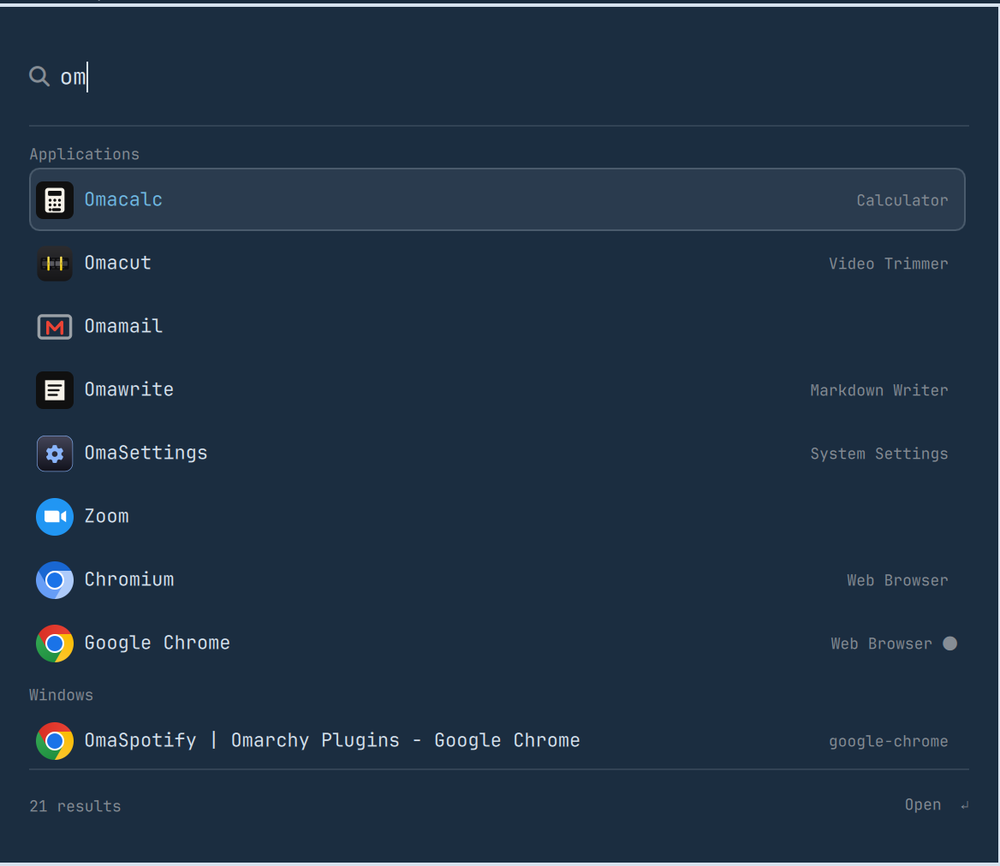

# OmaCast

A command palette for Omarchy. One keystroke, one card, and it answers with
apps, windows, menu actions, keybindings, maths, dates, colours, quicklinks,
snippets, script commands, clipboard history, emoji and files.



It runs inside the existing `omarchy-shell` process, so there is no daemon and
no second Quickshell.

## Install

```bash
omarchy plugin add https://github.com/TerrifiedBug/omacast.git --enable
```

After updating the plugin, run `omarchy-restart-shell` if changes don't appear.
Reopening the palette can leave the previous QML code cached in the running shell.

Open Settings to bind the palette key:

```bash
omarchy-shell shell summon io.github.terrifiedbug.omacast '{"scope":"settings"}'
```

Select **Open palette**, press Enter, press your key combination, then Enter to save.
The suggested `ALT + SPACE` is free in stock Omarchy; `SUPER + SPACE` keeps
opening the Omarchy menu.

You can also open it straight into a scope, or with the field prefilled:

```lua
o.bind("SUPER + SHIFT + V", "Clipboard", "omarchy-shell shell toggle io.github.terrifiedbug.omacast '{\"scope\":\"clipboard\"}'")
o.bind("SUPER + SHIFT + G", "GitHub search", "omarchy-shell shell toggle io.github.terrifiedbug.omacast '{\"query\":\"gh \"}'")
```

Hyprland animates the layer on open. To make it pop like the stock menu, add
this to `~/.config/hypr/hyprland.lua`:

```lua
hl.layer_rule({ match = { namespace = "omarchy-omacast" }, no_anim = true, animation = "none" })
```

### Bar button

Turn **Bar button** on in Settings. Enabling the plugin gives it a slot on the
right, with the button hidden by default. The CLI works too:

```bash
omarchy bar set io.github.terrifiedbug.omacast button true
omarchy bar move io.github.terrifiedbug.omacast left   # or center, right
```

An install from before the button existed has no bar slot. Run
`omarchy plugin disable io.github.terrifiedbug.omacast` and then
`omarchy plugin enable io.github.terrifiedbug.omacast right` to give it one.

## Remove

Before removing the plugin, unbind the palette key and clipboard shortcut in
Settings. If you enabled window management, turn it off and unbind its placement
and display shortcuts too. Turning it off restores the owned workspaces and
removes the startup loader.

```bash
omarchy plugin remove io.github.terrifiedbug.omacast
```

For manual cleanup, remove the `-- omacast: begin.` and
`-- omacast-windows: begin` blocks from `~/.config/hypr/bindings.lua`, including
their end markers. Remove the `BEGIN OMACAST WINDOWS` block from
`~/.config/hypr/hyprland.lua` and any hand-written OmaCast bindings, then run
`hyprctl reload`.
A few files are left behind if you want them gone:

```bash
rm ~/.local/state/omarchy/omacast-state.json   # pins, hidden rows, usage counts, last query
rm ~/.config/omarchy/omacast.json               # your config, if you created one
rm -r ~/.config/omarchy/omacast                 # your script commands, if you added any
rm ~/.cache/omarchy/omacast-rates.xml           # currency rates, if you turned them on
rm ~/.config/hypr/omacast-windows.lua          # generated window module, if enabled
```

## What it answers

| Type this | You get |
|---|---|
| `chrom` | Applications, ranked the way the Omarchy launcher ranks them, with a dot on the ones already running. Enter focuses a running app, Ctrl+Enter starts another |
| `fierfox` | One typo is forgiven on words of four letters or more, below every correctly spelled match |
| `resume` | Accent-insensitive search, including `Résumé` and equivalent Unicode forms |
| `lock`, `screenshot`, `theme` | Omarchy menu actions from anywhere in the tree, with their breadcrumb |
| `bg next`, `restart wifi` | Every `omarchy` command that takes no arguments and no sudo, unless the menu already has it |
| `lumon`, `theme cat` | Your installed themes, with a tick on the current one. Enter applies it |
| `full screen` | Your Hyprland keybindings, run straight from the palette |
| `12*7+3`, `20% of 250`, `2^10`, `255 to hex` | An answer row. Enter copies it |
| `10 km to miles`, `72f in c`, `5 GiB to MB` | Unit conversion |
| `days until dec 25`, `today + 90 days`, `friday`, `now`, `1790000000` | Date maths, the next weekday, unix time both ways |
| `3pm ist in pst`, `now in tokyo`, `time in berlin, new york` | Time zones, answered by `date` |
| `#ff8800`, `rgb(255,136,0)`, `hsl(30,100%,50%)` | The colour as HEX, RGB and HSL, with a swatch |
| `remind 30 check the oven`, `remind me at 17:30 to leave` | A reminder through `omarchy reminder` |
| `gh quickshell` | A quicklink, opened in your browser |
| `cb ssh` | Clipboard history, pasted or copied |
| `:smile` | Emoji, typed into the focused window |
| `f project invoice`, `~/coding/` | File and folder search through `fd`, opened with `gio` |
| `#TODO` | Files whose contents match, through `rg` |
| `win chrome` | Open windows, the full list, with switch and close |
| `place window right`, `left half`, `restore window` | Opt-in tiled placement and floating window controls |
| `kill firefox` | Your own processes by CPU use. Enter twice terminates, Ctrl+Enter twice kills |
| `jira ABC-1` | A script command you dropped in the scripts folder |
| `100 usd to eur` | Currency, if you turned it on |
| `proj api`, `ssh workstation`, `bm docs`, `panel music` | Optional projects, SSH hosts, bookmarks and enabled plugin panels |
| `ask how do tides work` | Your coding agent, if you turned it on |
| `github.com/omacom` | The link, opened |
| anything else | A web search with your engine |
| `?` | The cheat sheet: every prefix and keyword you have configured |

An empty field shows your pinned rows, then what you use most, then your open
windows. Ranking is the launcher's own tier order plus a small bonus for what
you launch often, capped so the exact name of a rarely used app still wins.

Use Ctrl+K on a stable result to set or remove an alias. An alias can take
arguments, so `work issue-123` can target a quicklink or script without
matching its name. Conflicting aliases and reserved keywords are rejected.

Settings has a separate **Learn query choices** toggle, off by default.
It learns a bounded preference for that query and scope. Passive learning
can't push a weaker textual tier above an exact match. **Reset ranking**
forgets a row's usage and query associations. **Clear learned query choices**
needs Enter twice and clears query history without removing aliases.

On a screen at least 1400 px wide, a preview pane opens beside the list when
the selected row has something to show: the head of a text file, an image, the
matching lines of a content search, the full clipboard entry, a snippet with
today's date filled in, or the command a row runs.
The whole card stays horizontally centered, including the preview pane.

## Window management

Enable Window management in Settings. It needs Hyprland's Lua layout API
(`hl.layout.register`). Disable other workspace-layout controllers before
enabling it. OmaCast leaves monitor scale, resolution and position alone.

Search for a command, or select a window with `win` and use Ctrl+K.
The palette captures its original window before taking keyboard focus.
A closed window or changed workspace is rejected; an action never falls back
to whichever window happens to be focused later.

Place Window Left and Right jump to the far-left and far-right slots.
Center chooses the slot closest to the horizontal center, favoring the current
row. Down chooses the nearest overlapping slot below. Repeating a placement
keeps that slot. An occupied destination swaps with the source; other windows
stay put. A tabbed group counts as one target.

Focus holds three slots at 25/50/25, including empty slots. The default Thirds
preset holds equal thirds. Even, Main, Rows and Grid are also available.
Settings can assign a preset to the captured workspace and bind the four
placement commands. These require a tiled window on a workspace assigned to an
OmaCast preset. Commands labelled Floating Window change the frame, including
halves, quarters, thirds, resizing and nudges. Group bars stay inside the usable
monitor area.

Settings > Window management also has `next display` and `previous display`
shortcut rows. No display shortcuts are assigned by default. They move the focused
window to the destination display's active workspace, cycling by Hyprland monitor
ID and wrapping at either end. They preserve tiled or floating state and leave
the destination's layout alone. An unassigned display keeps its native layout;
display moves don't assign a preset to it.

Restore Window returns to the initial frame, tiling slot and fullscreen state
from the current command chain. A manual floating move or resize starts a new
baseline. Restore history is transient and clears on a full Hyprland reload.

Custom sizes accept logical pixels or percentages, an anchor and optional
offsets. Add, edit or delete them in Settings, or configure them directly:

```json
{
  "windowManagement": {
    "enabled": true,
    "monitors": {"desc:YOUR_MONITOR_DESCRIPTION": "focus"},
    "workspaces": {"3": "thirds"},
    "customSizes": [
      {"id": "reading", "name": "Reading", "width": "66%", "height": "90%", "anchor": "center"}
    ]
  }
}
```

Monitor defaults match the full physical description, so they don't depend on
a connector keeping the name `DP-1`. Workspace overrides take precedence.
OmaCast writes `~/.config/hypr/omacast-windows.lua` and a marked loader in
`hyprland.lua` so presets load before the palette opens. Omarchy still controls
workspace numbering. Existing imported presets keep their underfill policy.

## File search

`f project invoice` finds `project/invoice.txt` as well as
`project-invoice.txt`. Every term must appear somewhere in the full path,
in any order. Terms are literal and case insensitive. Relevance uses every
term and favours matches in the filename, with smaller penalties for depth
and hidden paths.

The controls above the results cycle through file types, sort order and
the display limit. Click to go forward; right-click or hold Shift with
the keyboard shortcut to go back.

| Key, in Files | Control |
|---|---|
| `Ctrl+F` | All, Folders, Documents, Images, Videos, Audio, Code |
| `Ctrl+S` | Relevance, Newest, Oldest, Name A-Z, Name Z-A |
| `Ctrl+L` | 20, 40, 60, 100 or 200 displayed results |
| `Ctrl+R` | Cycle named search roots |

The display limit starts at 60. These choices stay in memory when you close
the palette. File types use filename extensions; Code also includes
`Dockerfile`, `Makefile`, `Containerfile` and `Justfile`. Tab still completes
the selected row.

`f ` and paths ending in `/` browse one level. Adding a term searches
recursively in that directory, or in the selected root for `f …`.
Filename matching folds Unicode accents and equivalent forms before the
candidate limit. Returned paths stay unchanged. Searches respect ignore
files, skip `.git`, `node_modules` and `.cache`, and don't follow symlinks.

Each walk collects up to 500 candidates and stops after three seconds.
Matches found before a timeout are kept. A separate metadata batch has a
one-second limit. Discovery and metadata each have a 256 KiB output budget.
Sorting happens before the display limit, but after these scan caps, so a
broad search can leave files out. The footer reports limits, timeouts and
read failures.

Discovery and metadata use NUL-delimited records, so spaces, tabs, newlines
and leading dashes in filenames survive unchanged.

`#TODO` searches file contents with ripgrep, collecting up to 200 matches
and skipping files larger than 2 MiB. Its result order is independent of the
Files controls. File, directory and matching-line previews stop at 16 KiB
and show a truncation marker when there is more text. Each preview is
cancelled after three seconds.

Add named roots in the config:

```json
{
  "fileRoots": [
    { "name": "Home", "path": "~" },
    { "name": "Work", "path": "~/work" }
  ]
}
```

An empty list uses Home. `f @Work invoice` selects a configured root;
Ctrl+R cycles roots for file and content search. Content after `#` stays
literal, including a leading `@`. A disconnected root reports an error
without blocking other scopes.

`protectPreviews` defaults to `true`. Credential, session and cache paths
are excluded before content reads, and every file, image and matching-line
preview gets a canonical-path check. Filenames may still be discoverable.
`allowProtectedPaths` explicitly permits individual files or directory
trees. Turning protection off also permits protected content reads.
These checks prevent accidental disclosure; they aren't a same-user sandbox.

## Local navigation

Enable each source in Settings, then configure its paths in the JSON file:

```json
{
  "projectsEnabled": true,
  "projectRoots": ["~/coding", "~/work"],
  "zoxideEnabled": false,
  "sshEnabled": true,
  "sshConfigFiles": ["~/.ssh/config"],
  "bookmarksEnabled": true,
  "bookmarkFiles": ["~/Documents/bookmarks.json"],
  "pluginPanelsEnabled": true
}
```

`proj ` finds project directories from the configured roots and, optionally,
zoxide. `ssh ` reads literal host aliases and bounded local Include files,
then opens the selected host in Omarchy's configured default terminal.
SSH starts interactive Bash so shell customizations are available. Enabled Ghostty
SSH integration loads after shell startup to preserve its terminal-type compatibility
handling. The host stays a literal argument.
It skips wildcard, negated and option-shaped hosts. `bm ` reads explicit
Chromium JSON or Firefox bookmark-export JSON files, never browser history
or a live SQLite database.

`panel ` opens enabled panel and overlay plugins, including panels hidden
from the bar. Membership is checked again immediately before summon.
Successful catalogs stay cached for up to a minute. Opening reuses those rows
and refreshes stale sources in the background. Config changes invalidate only
the affected sources. Disabled sources do no discovery and leave their prefixes
available to your own quicklinks and commands.

## Keys

| Key | Action |
|---|---|
| `↑` `↓`, `Ctrl+P` `Ctrl+N` | Move the cursor |
| `Ctrl+↑` `Ctrl+↓` | Jump to the previous or next section |
| `↑` in an empty field | Bring back the last query |
| `PgUp` `PgDn` | Move six rows |
| `Enter` | Primary action, named in the footer |
| `Ctrl+Enter`, `Shift+Enter` | Secondary action, also named in the footer |
| `Ctrl+K` | Every action for the selected row: copy a path, open a terminal there, delete a clipboard entry, reset its ranking, hide an app, and so on |
| `Ctrl+1` … `Ctrl+9` | Run the nth row. Hold Ctrl for a moment to see the numbers |
| `Tab` | Complete the row's keyword or name into the field |
| `Ctrl+.` | Pin or unpin the selected row |
| `Ctrl+U` | Clear the field |
| `Backspace` on an empty field | Leave the current scope |
| `Esc` | Close the actions panel, then clear the confirmation, the field, the scope, and finally close |

Destructive rows (shutdown, reboot, logout, hibernate, suspend, every `Remove`
row, `omarchy` commands that remove, reinstall or refresh things, and every
process) need Enter twice. The footer says so while the first press is armed.

Confirmation is tied to the current action definition and palette session.
Changed commands or menu guards need a fresh confirmation. Process signals
also verify the live PID's start time and owner before using a pidfd.

In-place toggles and supported value setters keep the query and selection,
then refresh their checkmark after the command succeeds. Missing helpers,
nonzero exits, timeouts and a busy runner stay visible. Actions that open
another UI dismiss first and launch detached.

A hidden app stays out of results and the empty palette. Type `?` and pick
Show hidden to bring it back.

## Configuration

Search the palette for `settings` and press Enter. General covers the search
engine, preview pane, currency rates, Ask agent and bar button. Shortcuts
sets the palette key and the `SUPER + CTRL + V` clipboard override. Library
holds quicklinks, snippets, commands, built-in quicklinks and script folders.
Window management has its own settings for presets, custom sizes, placement
shortcuts and display shortcuts.

Use the usual arrows and Enter to browse. Enter toggles an On/Off row or
opens a text field in the search input, with its value selected. Enter saves;
Esc cancels. Esc or Backspace in an empty search field returns to the parent
scope. An entry's Delete row needs Enter twice. Ctrl+Enter runs a secondary
action, such as removing a script folder or unbinding the palette key.
Toggling a setting keeps its visible highlight and scroll position.

Shortcut fields record the key combination you press. Enter saves and Esc
cancels. Backspace clears a window shortcut; press Enter to unbind it.
While recording, OmaCast inhibits compositor shortcuts for the palette so an
existing binding can be captured without running it.

Before saving, OmaCast checks Hyprland's loaded bindings and its own saved
shortcuts. A conflict shows the existing action and leaves the bindings unchanged.
If it can't verify the chord, it won't save it.

Snippet text uses `\n` for a newline and `\\` for a literal backslash in the
single-line editor. Reopening the field shows those escapes again.

Settings writes `~/.config/omarchy/omacast.json` as plain, indented JSON on
each save. It creates the file when needed, drops comments and keeps unknown
keys, including fields on your quicklinks, snippets and commands. Hand edits
can still use comments and trailing commas, and apply without a restart.
Advanced's **Edit config file** row opens your editor and creates the file
from `omacast.example.json` if it doesn't exist.

Malformed or unreadable config and state files stay untouched. OmaCast keeps
the last good data and names the error in the footer. Repair and save the file
to resume editing. A failed settings save leaves the editor open. Pending
state changes stay dirty after a write failure and are flushed before the
plugin unloads, including recent pin, hide and ranking changes.

Storage errors stay in the palette. An armed destructive action keeps its
confirmation prompt above status errors.

Shortcut settings own a marked block at the end of
`~/.config/hypr/bindings.lua`. Toggle the clipboard override off to restore
Omarchy's clipboard manager, or use Unbind on the palette key. Removing the
whole marked block undoes both. OmaCast reloads Hyprland after a change and
restores the previous file if Hyprland reports a config error. Existing
hand-written OmaCast bindings outside the block need removing by hand.

```json
{
  "searchEngine": "ddg",
  "quicklinks": [
    { "name": "Work GitHub", "keyword": "wgh", "url": "https://github.com/my-org/{argument}" },
    { "name": "Jira", "keyword": "j", "url": "https://jira.example.com/browse/{argument | uppercase}" }
  ],
  "snippets": [
    { "name": "Signature", "keyword": "sig", "text": "Cheers,\nDanny" },
    { "name": "Today", "keyword": "td", "text": "{date format=\"yyyy-MM-dd\"}" }
  ],
  "commands": [
    { "name": "Rebuild site", "keyword": "rb", "command": "make -C ~/site build", "terminal": true },
    { "name": "Prune docker", "command": "docker system prune -f", "confirm": true }
  ],
  "scriptDirs": ["~/dotfiles/raycast"],
  "preview": true,
  "currency": false,
  "ai": false
}
```

`searchEngine` is the keyword of the quicklink used for the web fallback, `g` by
default. Built-ins are `g`, `ddg`, `yt`, `gh`, `aw`, `aur` and `w`. They live in
the plugin, so an update can fix a search URL without touching your file, and
your own quicklink with the same keyword wins. Hide one with
`{ "hiddenQuicklinks": ["ddg", "aur"] }`, or set `"builtinQuicklinks": false` to
start from nothing, which drops the web fallback row too.

Quicklinks, snippets and commands take the same tokens: `{argument}`,
`{clipboard}`, `{selection}`, `{date}`, `{time}`, `{datetime}`, `{day}` and
`{uuid}`. `{date}` and friends take a `format` attribute built from
`yyyy MM dd HH mm ss`. Pipe modifiers are `trim`, `uppercase`, `lowercase`,
`percent-encode` and `raw`. Values in a URL are percent-encoded unless you ask
for `raw`.

Clipboard and selection tokens read at most 64 KiB each and are cancelled
after three seconds. An oversized, failed or timed-out read cancels the
action. If the palette has already closed, OmaCast sends a notification.

Command arguments are passed as positional parameters, so `rb --clean` runs
`make -C ~/site build "--clean"` without a shell re-parsing what you typed.

`preview` switches the preview pane off. `currency` and `ai` are off until you
turn them on; see Privacy below for what they do.

## Script commands

Drop an executable script into `~/.config/omarchy/omacast/scripts/` (search the
palette for `scripts` to open or create the folder) and it becomes a row.
OmaCast reads script-command headers:

```bash
#!/bin/bash
# @omacast.schemaVersion 1
# @omacast.title Search Jira
# @omacast.mode silent
# @omacast.argument1 { "type": "text", "placeholder": "issue" }
# @omacast.needsConfirmation false
xdg-open "https://jira.example.com/browse/$1"
```

The file name is the keyword, so `jira.sh` answers `jira ABC-1`. Up to three
arguments follow the keyword, split on spaces, with `"double quotes"` keeping
spaces together. Missing arguments open a form when `scriptForms` is on.
Valid typed arguments run directly. With forms off, a missing required value
can't run. Headers also accept `//` comments or `--` comments.

| Mode | What happens |
|---|---|
| `silent` | Runs in the background |
| `compact` | Runs for up to 10 seconds, then the last line it printed shows as a notification |
| `fullOutput` | Runs in a floating terminal |
| `inline` | Runs each time the palette opens, or every `refreshTime` (`30s`, `5m`, `1h`), and its first line becomes the row's subtitle. Enter runs it again |
| `results` | Runs once and publishes a bounded selectable JSON-lines list |

A script without the executable bit is listed as `not executable` and never
runs. Output is capped at 64 KB. `@raycast.icon` is used when it is an emoji and
ignored otherwise. More folders go in `scriptDirs`.

Arguments support defaults, choices and whole-value validation:

```bash
# @omacast.argument1 {"type":"text","placeholder":"Issue","validation":"[A-Z]+-[0-9]+"}
# @omacast.argument2 {"type":"dropdown","placeholder":"Target","options":[{"title":"Staging","value":"stage"},{"title":"Production","value":"prod"}],"default":"stage"}
# @omacast.argument3 {"type":"text","placeholder":"Note","optional":true}
```

Tab and Shift+Tab move between fields; arrow keys change choices. Enter
submits valid values and Escape cancels. A secondary terminal action stays
a terminal action after submission. Values reach the executable as literal
arguments. Validation supports literals, character classes and simple
quantifiers. It rejects groups, alternation, backreferences and lookarounds
rather than running a backtracking pattern on the UI thread.

A `results` script prints this protocol to stdout:

```jsonl
{"version":1}
{"id":"greeting","title":"Copy greeting","action":{"type":"copy","text":"hello"}}
{"id":"docs","title":"Open documentation","action":{"type":"url","url":"https://example.com"}}
{"id":"terminal","title":"Open terminal","action":{"type":"argv","argv":["alacritty"]}}
```

The other action type is `open` with an absolute `path`. Results need unique
IDs and stop at 200 rows, 64 KiB or ten seconds. Malformed or oversized
documents fail visibly. Filtering doesn't execute anything; selection is
required, and `argv` actions also need confirmation. Output is never QML or
implicit shell syntax. Scripts remain trusted user code.

## Optional input and answers

The picker helper returns selected data on stdout:

```bash
printf '%s\n' 'one' 'two' |
  ~/.config/omarchy/plugins/io.github.terrifiedbug.omacast/bin/omacast-pick --prompt 'Choose'
```

`--json` accepts an array of `{id,title,subtitle?,value}` objects. Requests
use private runtime files and accept at most 200 choices and 64 KiB. Escape
cancels; `--timeout` accepts 1 to 300 seconds. Selected values are printed
literally, including shell-looking text.

`inlineAi` adds explicit send and cancel controls, with plain-text answers
inside the palette. Typing alone sends nothing. The default `omp` command
uses isolated HOME/XDG/config directories, disables built-in tools and
extensions, and avoids normal MCP discovery and file attachments.
It needs provider credentials exported into the shell process environment;
normal stored logins aren't inherited. `agentCommand` can select an explicit
trusted answer command, which receives the question as its last argument.
That custom command controls its own behaviour and authentication.
The existing `ai` terminal handoff is unchanged.

`semantic` ranks a source-balanced, query-related shortlist of up to 32
local candidates through a real embedding service. Set `semanticModel` and,
if needed, `semanticEndpoint`; the default is `http://127.0.0.1:11434`.
Only loopback HTTP endpoints are accepted. Suggestions stay below
deterministic local sections and require selection. This is a bounded
fallback, not a full-catalog vector index. A missing model or service gives
a visible prerequisite error.

## State

Pins, hidden rows, aliases, usage counts and last-query recall live in
`~/.local/state/omarchy/omacast-state.json`. Usage keeps at most 400 keys.
Aliases keep at most 200 entries. Opt-in query learning keeps up to 200
hashed contexts with eight result associations each. Enabling it establishes
mode `0600` before writing associations; atomic saves preserve that mode.

Hashes avoid readable learning queries, but predictable queries can still
be guessed. Clipboard text, content-search terms, processes and agent prompts
don't enter query learning. Last-query recall is separate: it still stores
the last query as readable text for `↑`. Delete the file to start over:

```bash
rm ~/.local/state/omarchy/omacast-state.json && omarchy-restart-shell
```

Tiled slot positions and native fallback layouts have a separate, non-executable
cache at `$XDG_RUNTIME_DIR/hypr/$HYPRLAND_INSTANCE_SIGNATURE/omacast-window-slots`.
It keeps sparse groups in place across configuration reloads. The cache uses
live window identities and is scoped to one compositor session.

## Privacy

Default search uses local desktop entries, menu files, clipboard history and
filesystem tools. Activating a URL or a web search opens your browser.

These opt-in settings add data flows:

- `currency` downloads
  `https://www.ecb.europa.eu/stats/eurofxref/eurofxref-daily.xml` at most once
  a day when the palette opens.
- `ai` hands your selected question to `omarchy agent prompt`.
- `inlineAi` sends only after you choose Send. Its configured provider decides
  where the question goes.
- `semantic` sends the question and bounded candidate labels to your configured
  loopback embedding service.

Disabled integrations do no network or agent work.

## Dependencies

The core palette has no required helper daemon. It uses these local tools:

| Tool | Used for |
|---|---|
| `fd` | File search |
| `rg` (ripgrep) | Content search and its preview |
| `gio`, `gdbus` (glib2) | Opening files and folders, revealing a file in the file manager |
| `wtype`, `wl-clipboard` | Pasting clipboard entries, snippets and emoji |
| `jq` | Used by the stock clipboard helpers OmaCast calls |
| `ps` (procps), Linux pidfds | Process discovery and identity-safe signals |
| GNU coreutils, GNU `awk` | Metadata, canonical paths, bounded output and NUL-record policy filtering |
| `curl` | Currency rates, only when turned on |
| `bash` | Menu actions, guards, keybinding dispatch, scripts |
| `python3` | Unicode filename filtering, owned actions, navigation and optional adapters |
| `zoxide` | Optional project history |
| `omp` or `agentCommand` | Optional inline answers |
| Local `/api/embed` service and model | Optional semantic suggestions |

Window actions use Quickshell's native socket components and run inside
Hyprland. They don't spawn `hyprctl`, Bash or Python, and need no extra daemon.

## What it reuses from Omarchy

`shell/services/AppLibrary.qml` is loaded at runtime for the app list, its icon
index, hidden-entry filtering and launch feedback. `shell/plugins/menu/MenuModel.js`
is vendored in `vendor/` to parse the menu JSONC and build the same `when:` and
`checked:` guard batch the menu runs. Both are MIT, see `NOTICE`. Sharing them
keeps the palette in agreement with the rest of the desktop about what your apps
and menu actions are.

Development checks use Quickshell 0.3.2 and the installed Omarchy shell modules.

## Development

```bash
omarchy plugin add "file://$PWD" --enable --yes
node --test test/
```

`Model.js` holds matching, rows and config/state logic. `Learning.js`,
`Navigation.js`, `FilePolicy.js`, `ActionPolicy.js` and `ScriptModel.js`
hold their pure domain rules. `Sources.qml` owns catalogs and module
lifecycles; `JsonStore.qml` owns protected atomic persistence.
`Omacast.qml` and `ScriptForm.qml` draw the palette and own input.

The suite runs real FileView, Sources and adapter processes with temporary
HOME/XDG directories. Palette fixtures use the actual visual tree in an
offscreen Qt Window, replacing only the native LayerShell envelope.
A rendering regression checks that the visible highlight follows selection,
scrolled Settings retain their position, and the palette disappears on close.
These fixtures don't reload the installed plugin or use your clipboard.

Separate manual captures covered Settings, picker filtering and form validation.
Neither the captures nor the tests prove native Wayland keyboard grabs, IME
composition, focus restoration or screen changes. Real provider inference
wasn't exercised.

A few IPC methods help when you are working on it:

```bash
omarchy-shell shell call io.github.terrifiedbug.omacast setQuery '10 km to miles'
omarchy-shell shell call io.github.terrifiedbug.omacast inspect '{}' | jq
omarchy-shell shell call io.github.terrifiedbug.omacast select 2
omarchy-shell shell call io.github.terrifiedbug.omacast runAction copy-path
```

`runAction` takes any id from `inspect`'s `actions` list, the same ones Ctrl+K
shows.

## Theme compatibility

Theme colors use a namespaced `qs.Commons.Color` import to avoid Qt 6.12's
`Color` name collision. This keeps the existing palette roles and fallbacks
without changing the plugin's Omarchy requirements.

## License

MIT. See `LICENSE` and `NOTICE`.
